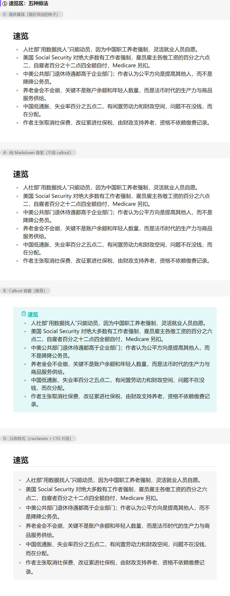
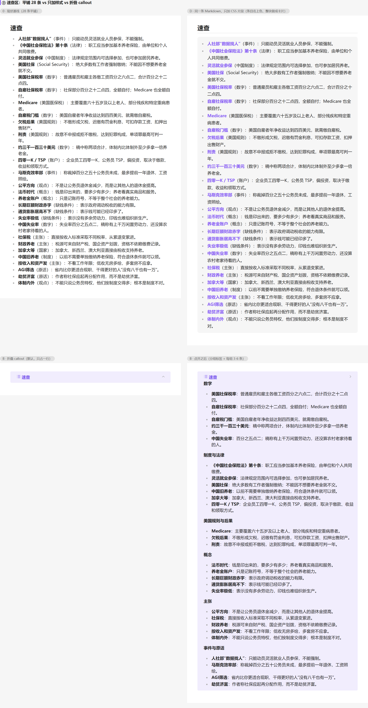
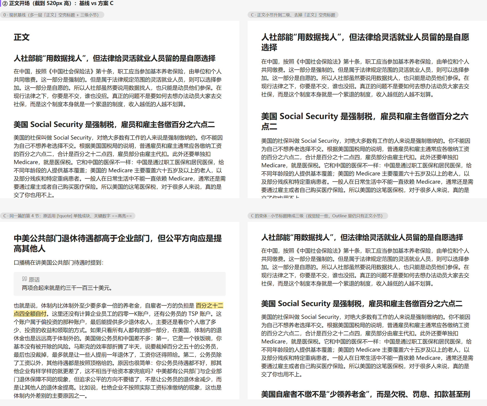

# Obsidian 笔记排版：现在为什么难看、成熟做法是什么、四套可选方案

> 触发：用户拿真实的导出产物（「速览」与「速查」两个片段）反馈「内容是很不错的，但实际导出到
> Ob 笔记里就很丑」，要求调研成熟笔记的排版做法并给方案，且**明确要求不要凭空捏造**——
> 每个排版选择都要能指向已有项目的成熟设计。
>
> 这份文档就是那次调研：第 1 节对着真实产物指出难看的三个可指认原因；第 2 节把所有候选做法
> 连出处一起摊开（含两条「看似合理但被证据否掉」的做法）；第 3 节给四套成品方案（同一份内容、
> 只改排版，可直接在 Obsidian 里打开对比）；第 4 节列落地要动的文件与代价；第 5 节是出处清单；
> 第 6 节是诚实清单。
>
> 对比库在 `note-candidates/排版方案demo/`（打开方式见该目录的 README）；
> 图片是用近似 CSS 渲染的，标定方法与局限写在诚实清单里。

## 0. 结论

**难看在三个地方，都是结构问题，不是「主题不好看」：**

1. **速览**：6 条同构的项目符号，没有容器、没有标题权重——它和正文的唯一区别是「上面有一条标题」。
   而且 `## 速览 / ## 正文 / ### 小节` 这三层里，`## 正文` 是个空壳标题：它只宣布「下面是正文」，
   不承载任何内容，却占着二级标题的位置。（实测：700px 栏宽下速览区高 370px，与正文第一段之间没有任何视觉隔断。）
2. **速查**：28 条平铺，**类别只写在行内括号里**，所以「类别」看不见、也就没法横向比——
   而这一段自己的用途（提示词里写着）恰恰是「横向比、回头查」。实测：平铺 28 条占 **1093px**
   （约 45 行行高），每条平均 42 字（说明部分平均 24 字）、长度都差不多、密度完全均匀，眼睛没有落点。
3. 整篇没有用到任何 Obsidian 自己的结构（callout / 折叠 / 分隔线），于是一篇三千多字的笔记
   在阅读视图里就是「标题 + 段落」的连续平面。

**推荐方案 B：速览装进 `> [!summary] 速览`、正文保持裸 `##` 标题、速查装进折叠的
`> [!example]- 速查` 并按类别分组。** 三条依据：速览用的 `summary` 是 Obsidian **官方为摘要准备的
callout 类型**（`abstract` 的别名，官方 Web Clipper 的默认剪藏模板就是用它装 Description）；
折叠是官方语法，把它给「回头查」的速查、不给「扫一眼」的速览，是按用途分的；正文不进容器，
长文读起来还是长文。

**主要代价**：应用内（结果页、画布卡片预览）自己也要认识 callout，否则那两处会显示成
「引用块 + 字面的 `[!summary]`」。这是最容易漏的一处，改动清单见第 4 节。

另外两套备选：**A（纯 Markdown，零 Obsidian 特性，换任何工具都能看）**、
**D（Markdown 一个字不改，只加 `cssclasses` + 一份 CSS 片段）**。
**C 是把语法用满的上限版**，用来量代价——不建议当默认。

## 1. 现状（基线）与诊断

基线的结构（`note-candidates/排版方案demo/0-现状基线.md`）：

```md
# 中美社保对比，有哪些不同?

## 速览
- 人社部“用数据找人”只能动员，……
（6 条）

## 正文
### 人社部能“用数据找人”，但法律给灵活就业人员留的是自愿选择
（5 段，每段一个 ### 判断句小标题 + 一段行文）

## 速查
- **人社部“数据找人”**（事件）：只能动员灵活就业人员参保，不能强制。
（28 条）
```

三个问题的具体形态：

- **速览**没有自己的「盒子」。它和第 2 段之间只隔着一次标题换行；读者扫到的前 6 条和后面的
  正文段落用的是同一种视觉语言（都靠左对齐的黑字）。
- **速览与速查的性质是一样的**（都是「正文之外的旁注」），但排版上它们和正文小节混在同一套
  标题层级里——阅读视图右侧的大纲（Outline 核心插件）会把「速览 / 正文 / 速查 / 5 个小节」
  平铺成 8 条，其中 3 条不是内容。
- **速查的类别在行内**。用户段落的用途是「横向比」，但 28 条里没有任何两条在结构上可比——
  类别（事件 / 法律 / 数字 / 概念 / 主张…）只以圆括号出现在句子中间，眼睛要逐个找。

这些判断不是靠感觉：`速查` 的用途、`速览` 的用途都写在提示词块自己的注释里
（`packages/shared/src/prompt.ts` 的 `PROMPT_SULAN`），而现在的排版没有兑现它们。

## 2. 调研：成熟项目怎么做

### 2.1 速览 → Obsidian 官方就有为它准备的 callout 类型

Obsidian 的 callout 语法是 `> [!类型] 标题`，其中 `abstract` 一族的别名就是
`summary`、`tldr`（官方 Callouts 文档的 Supported types 表）。也就是说这是官方**为摘要预留的语义槽**，
不是我们自己发明一个盒子。

真实项目怎么用它：

- **Obsidian 官方 Web Clipper（MIT）** 的 `callout` 过滤器签名是
  `{{variable|callout:("type", "title", foldState)}}`，`foldState` 为 true 时折叠。社区实际在用的
  YouTube 模板里就是 `callout:("summary","Description",true)`。
- **Obsidian 官方论坛上真实在跑的「视频文稿摘要」提示词**（帖子 96851）直接把 callout 当内容分型用：
  关键结论 `[!check]`、必记 `[!important]`、警告 `[!fail]`、引文 `[!note]`、思考题 `[!question]`、
  延伸 `[!example]`，并规定**每个 callout 与前后内容之间必须空一行**。
- **Readwise** 的 Obsidian 导出把 summary 放进属性（front matter），而不是正文块——这是另一种成熟选择，
  但它适合「摘要是一个字段」的场景，不适合我们「速览是 6 条可扫读的条目」。

### 2.2 速查 / 术语表 → 官方术语表是「一条一个标题」，28 条不适用；实战派用「分节 bullet」

- **Obsidian 官方帮助库自带的 Glossary** 的写法是：每条术语一个 `## 术语` 标题 + 一句话定义 +
  交叉引用 `[[#property]]`。这是官方给术语表定的调子——适合「条目少、每条都值得单独成为一节」的
  小词表；**28 条照抄会得到 28 个二级标题**，大纲直接爆炸，所以不能照抄。
- 真正对口的是上面那个论坛帖子对文末的处理：**按用途分节的 bullet 清单**
  （IDEAS / QUOTES / TIPS / REFERENCES，各 1-10 条）。也就是说「分组标签 + 组内短句」
  是有真实先例的，只是它把分组做成加粗标签而不是标题。

**两条被证据否掉的做法**（先排除，免得再走一遍）：

- **定义列表 `术语\n: 说明`**：Obsidian 不渲染（它的扩展语法清单里没有这项，官方论坛的请求帖
  224 至今没有实现）。要用只能装插件（`shammond42/definition-list`），而它的 README 自己写着
  「因为定义列表不是标准 Obsidian 标记，**任何主题都不认它**」，且不支持多行定义与嵌套。
  为了排版好看而给用户的库装插件，代价不成比例。
- **表格**：这个仓库已经实测过——窄阅读区里表格单元格最大塞进 164 字、5 处用分号串了多条，
  这是上一轮把速查从表格改成条目清单的原因（见 `packages/shared/src/prompt.ts` 的 `PROMPT_SULAN`
  注释与 `note-candidates/measure-table.mjs`）。Markdown 表格的单元格不能换行，复合内容没有中间态。

### 2.3 折叠（`-` / `+`）该给谁用

官方语法：类型标识符后加 `-` 默认折叠、`+` 默认展开。成熟用法都拿它压缩**长而不常读**的块：
Web Clipper 的模板把 Description 与 Transcript 都做成折叠的。

按这条推：**速查折叠、速览不折叠**。速览的用途是「扫一眼就知道值不值得读」，折起来就违背了用途；
速查的用途是「回头查」，折起来之后它只占一行，需要时才展开。实测：速查区从 **1093px 压到 125px**（8.7×）。

### 2.4 正文 → 越不动它越好；要动就动这两处

- **Obsidian 官方帮助站的长文自己**就是「`##` 小节 + 段落，块与块之间用 `---` 分隔」——
  callout 文档那一页里，每个类型的示例之间就隔着 `---`。
- 本仓库已经有一份成文版的排版样例（`docs/samples/insight-v4-layout-sample.md`）：
  开头导读用 `>` 引用块、`---` 分隔、观点用**加粗主张句**领起、原话用 `> 引用` 就地给出。
  B 方案删掉 `## 正文` 空壳、把正文小节升到 `##`，方向与那份样例一致——它也把「观点」提成
  唯一一层内容标题，不在外面再套一层空壳。
- 加粗主张句与「笔记顶部的一句话摘要」是渐进式摘要（Progressive Summarization）里
  有名字的做法（Layer 2 加粗、Layer 4 executive summary），不是随手加粗。

### 2.5 「一个字都不改 Markdown」这条路的成熟机制：`cssclasses` + CSS 片段

Obsidian 1.4+ 的默认属性里有 `cssclasses`，官方描述是「Allows you to style individual notes using
CSS snippets」——即**给个别笔记挂一个 CSS 类**。CSS 片段放在库的 `.obsidian/snippets/` 下，
在外观设置里开启。成熟用例：Minimal 主题的 helper classes 就是同一个机制
（在 front matter 里挂 `cssclasses: [cards]` 之类，只影响这一篇的表格布局）。

这条路的边界很清楚：**它只能改观感，改不了结构**——28 条平铺还是 28 条平铺，
只是每条有了颜色落点、整块有了卡片感。

### 2.6 三个容易踩的细节

1. **必须自带中文标题**：不给标题时，Obsidian 用类型标识符做标题（Title Case），也就是会显示
   英文的「Summary」「Example」。所以写法是 `> [!summary] 速览`，不是光秃秃的 `> [!summary]`。
2. **callout 与前后内容之间要空一行**（官方论坛那个提示词里把它列成硬规则）。嵌套在 callout 里的
   每个行首都要带 `> `。
3. **类型名写错不会报错，会静默回落到 `note`**（官方原文：不支持的类型默认为 note 类型）。
   写 `[!速览]`、`[!summaryy]` 都会得到一个蓝色 note 框。所以提示词里要把类型名写死。

## 3. 四套方案（同一份内容，只改排版）

四套的 demo 都在 `note-candidates/排版方案demo/`，可以直接在 Obsidian 里打开这个文件夹当库对比。
下面表格里的高度是**本次实测**（700px 栏宽、16px 正文，用 `tools/render-preview.mjs` 量的）：

| | 速览区 | 速查区 | 要改 Markdown？ | 换别的工具还好看？ |
| --- | --- | --- | --- | --- |
| 0 基线 | 370px | 1093px（28 条平铺） | — | 是（但也就是现在这样） |
| A 纯 Markdown | 370px | 1093px（分组标签 + 组内 3-6 条） | 是 | 是 |
| B Callout 容器 | 399px | **125px 折叠 / 1314px 展开** | 是 | 一般（`[!summary]` 会原样露出） |
| C 语法上限 | 399px | 6 个折叠 callout | 是 | 否 |
| D 只改样式 | 460px | 1274px | 否（只加一行 front matter） | 是 |

速览区四种排法（0 / A / B / D；C 的速览与 B 相同，没重复放）：



速查区：平铺 28 条 vs 只加样式 vs 折叠（B 折叠 / B 展开）：



正文开场与「原话引用块 / 高亮」；右下角是同一篇把小节降成三级 `###` 的变体
（视觉轻一些，注意 Outline 里仍然只有正文小节，因为速览与速查都不是标题）：



整篇对比（同一份内容）：[基线整篇](obsidian-note-typography-baseline-full.png) ·
[方案 B 整篇](obsidian-note-typography-b-full.png)

### 方案 A · 纯 Markdown 骨架

删掉 `## 正文` 空壳、正文小节升到 `##`、三个区之间加 `---`、速查按类别分组（加粗标签 + 组内条目）。

```md
## 速览
- ……

---

## 人社部能“用数据找人”，但法律给灵活就业人员留的是自愿选择
（段落）

---

## 速查

**数字**

- **美国社保税率**：普通雇员和雇主各缴工资百分之六点二，合计百分之十二点四。
```

适合：不想让产物依赖 Obsidian 特性（同一份文件也要发到别处）、或以后可能换渲染工具。
代价：在 Obsidian 里它就是「朴素但整齐」，速览区仍然没有容器感。

### 方案 B · Callout 容器（推荐）

```md
> [!summary] 速览
> - 人社部“用数据找人”只能动员，……

## 人社部能“用数据找人”，但法律给灵活就业人员留的是自愿选择
（段落，原话就地用引号或 `>`）

> [!example]- 速查
> **数字**
>
> - **美国社保税率**：普通雇员和雇主各缴工资百分之六点二，合计百分之十二点四。
>
> **制度与法律**
>
> - ……
```

三个决定与依据：速览用 `[!summary]`（官方摘要类型）且**不折叠**；速查用 `[!example]-`（折叠）并分组；
正文**不进容器**，保持裸标题 + 段落的阅读节奏。速查的类别从行内括号提升成结构（分组标签），
28 条拆成 6 组、每组 3-6 条——分组这一条取自 2.2 的实战先例，条目措辞一个字没动。

### 方案 C · Obsidian 语法上限

在 B 之上：原话用 `> [!quote] 原话` 单独成块、关键数字 `==高亮==`、速查按类别拆成 6 个折叠 callout
（分类即容器，折叠时文末只有 6 行）。

用来量代价：容器变多、`==` 与 callout 的观感都更抢眼；正文区整体高度比基线多 169px
（二级标题更容易折行 + 一个引用块）。**不建议当默认**——它把「好看」推到「花」的一侧。

### 方案 D · 只改样式（`cssclasses` + CSS 片段）

Markdown 与基线逐字一致，只在 front matter 加：

```yaml
cssclasses:
  - scribeflow
```

配套片段在 `note-candidates/排版方案demo/snippets/scribeflow.css`：给 `## 速览` / `## 速查` 后面
的清单做成浅色卡片、给速查条目名上强调色、标题加一条淡分隔线、正文行距放宽到 1.85。

适合：不想动产物、只想在自己的库里变好看；或者先看效果再决定要不要改产物。
代价（实测，不粉饰）：卡片与行高让速查区从 1093px **涨到** 1274px——它买到的是「区分度」，
不是「紧凑」；而且片段要装进 `.obsidian/snippets/` 才生效，换库、换机器都要重装一次。

## 4. 落地要动什么

方案 B 落到产品里需要四处改动（按必要性排序）：

1. **提示词**：`packages/shared/src/prompt.ts` 的 `PROMPT_SULAN` 结构段——把「速览 / 正文 / 速查」
   三段的容器写法写死（含「速览必须写 `> [!summary] 速览` 且不折叠」「速查写 `> [!example]- 速查`
   并按类别分组、每组 3-6 条」「正文小节升到 `##`、删除 `## 正文`」），并把 2.6 的三条细则写进去。
2. **应用内要认 callout**（最容易漏的一处）：结果页、画布卡片预览、设置页预览都走
   `apps/web/src/lib/markdown.ts` 的 `renderMarkdown`（marked + DOMPurify）。marked 不认识 callout，
   会把 `> [!summary] 速览` 渲染成「引用块 + 字面的 `[!summary]`」。**这不是推测**——本次做预览时
   第一版就复现了它（截图里直接出现 `[summary] 速览`）。改法：给 marked 加一个 block 级扩展
   （`note-candidates/排版方案demo/tools/render-preview.mjs` 里那 40 行可直接搬），
   样式加在 `apps/web/src/styles/markdown.css` 的 `.markdown-body` 作用域内，颜色走令牌。
3. **测试**：`packages/shared/src/prompt.test.ts` 里已有一条「速查段不用表格」的断言，
   按同样的形状补一条「速览段用 `[!summary]` 且必须带中文标题」。
4. **文档**：`docs/nodes.md` 的节点说明 + `CHANGELOG.md`。

选 D 的话还要多两件事：`engine.ts` 拼 front matter 时加 `cssclasses`（可给它一个开关），
以及把 `note-markdown.ts` 的 `NOTE_OWN_FIELDS` 补上新字段——否则设置页「库里用过的属性名」
会把这个我们自己写的字段当成候选推荐给用户。

## 5. 出处（对着这些内容核的，不是凭印象）

- Obsidian Callouts 官方文档（类型与别名表、折叠、不支持的类型回落 note、自定义标题）：
  <https://help.obsidian.md/editing-and-formatting/callouts>
  （正文源文件在 `github.com/obsidianmd/obsidian-help` 的 `en/Editing and formatting/Callouts.md`）
- Web Clipper 的 `callout` 过滤器（type / title / foldState 三个参数）：
  <https://help.obsidian.md/web-clipper/filters>
- 社区在用的 YouTube 剪藏模板（`callout:("summary","Description",true)`）：
  <https://github.com/community-archive/web-clipper-templates/blob/main/templates/youtube-full-description-transcript.json>
- 官方论坛的「视频文稿摘要」实战提示词（callout 分型、空行硬规则、文末分节 bullet）：
  <https://forum.obsidian.md/t/create-perfect-summaries-of-video-transcripts-with-ai-for-free/96851>
- Readwise 的 Obsidian 导出模板（summary 进属性；引文写成一条 bullet，位置与跳转链接跟在圆括号里）：
  <https://docs.readwise.io/readwise/docs/exporting-highlights/obsidian>
- Obsidian 官方 Glossary（`## 术语` + 一句话定义 + `[[#交叉引用]]`）：<https://help.obsidian.md/glossary>
- 定义列表：请求帖 <https://forum.obsidian.md/t/add-support-for-definition-lists/224>，
  补丁插件 <https://github.com/shammond42/definition-list>（README 自述「任何主题都不认它」）
- `cssclasses` 属性：<https://help.obsidian.md/editing-and-formatting/properties>；
  CSS 片段：<https://help.obsidian.md/extending-obsidian/css-snippets>；
  同机制的成熟用例：<https://github.com/kepano/obsidian-minimal/blob/master/docs/Features/Helper%20classes.md>
- 渐进式摘要（Layer 2 加粗 / Layer 4 一句话摘要）：
  <https://fortelabs.com/blog/progressive-summarization-a-practical-technique-for-designing-discoverable-notes/>
- 第 3 节表格里的高度、第 0/1 节的条数与字数：本次实测（`tools/render-preview.mjs` 量高度；
  字数由脚本数 `0-现状基线.md` 得到），不是估算。
- 预览图的样式数值（16px / 700px / 标题字号 / callout 配色与几何）：从 Obsidian Publish 的
  `app.css`（2026-10-14 抓取）量得，只取数值、未收录原文。

## 6. 诚实清单

- **预览图是近似渲染，不是 Obsidian 的截图。** 生成方式：`marked` + 本仓库自写的 callout/highlight
  扩展渲染成 HTML，套一份我自己写的 CSS；这份 CSS 的数值（16px 正文、700px 栏宽、标题字号、
  callout 的圆角/内边距/13 类颜色与图标）是**从 Obsidian Publish 的 `app.css` 里量出来的**
  （只取数值、未收录原文，也没进仓库）。未复刻：`mix-blend-mode`、属性面板的交互样式。
  图标里 `quote` 用 Lucide 的 quote 近似（Obsidian 用的是自带 glyph）。
- **真实观感必须用真 Obsidian 看一次**：demo 库在 `note-candidates/排版方案demo/`。
  我没有办法在本机自动截 Obsidian 的图（没有自动化入口），所以第 3 节的「好看不好看」是判断，
  不是测量；能测量的只有高度（表格里那些 px）。
- **demo 的内容是按用户给的两张截图转录的**，个别字句可能与原稿有出入；本次要比的是排版。
  速查的 28 条按类别重新分组、顺序变了，**措辞一条都没改**。
- **未验证**：① 方案 D 的 CSS 片段在真机上的效果——`cssclasses` 挂载的容器元素我在文档里
  确认过是「个别笔记」级别，但具体落到哪个元素、选择器要不要调整，只有装了才知道；
  ② Live preview 下的表现：官方文档没有列出 callout 在两视图下的差异，但有社区 bug 帖报告
  「引用块里的列表在 Live preview 不渲染」——建议在实时预览里也看一遍；
  ③ 中文界面下 callout 标题的默认显示（我们每个 callout 都自带中文标题，不受影响）。
- **没做的事**：第一轮调研时没有改任何产品代码，没有对 28 条做删减（用户明确说内容不错），
  没有动 `PROMPT_SULAN` 之外的其他提示词块。（当天用户选定方案 B 后的落地见下一节。）

## 7. 落地记录（2026-10-14，用户选定方案 B）

### 改了什么

| 文件 | 改动 |
| --- | --- |
| `packages/shared/src/prompt.ts` | `PROMPT_SULAN` 的结构段换成 B 的形状：速览 `> [!summary] 速览`（不折叠）、正文小节 `##` 且禁 `###` 与空壳标题、速查 `> [!example]- 速查`（折叠 + 分类别组，每组 3-6 条）；块描述同步 |
| `apps/web/src/lib/obsidian-callout.ts`（新） | marked 的 callout 块级扩展：标题行 + 内容 + 折叠（原生 `<details>`，不引 JS）+ 类型→色调映射。**不搬 Obsidian 的图标与自带 13 色**——那是 Obsidian 的视觉语言，应用里走本仓令牌 |
| `apps/web/src/lib/markdown.ts` | 模块加载时注册一次扩展：结果页、画布卡片预览、设置页预览三条路径一起生效 |
| `apps/web/src/styles/markdown.css` | `.markdown-body .callout` 的样式（四种语气 + 中性，颜色只走令牌；折叠态把 `<summary>` 自带三角换成右侧 `›`） |
| `apps/web/src/lib/obsidian-callout.test.ts`（新）、`packages/shared/src/prompt.test.ts` | 扩展的行为测试 + 提示词形状断言 |

### 验证（三层，都是真跑）

1. **单元**：`pnpm test` 全绿（新增 5 条渲染测试 + 1 条提示词断言；旧断言一条没删）。
2. **应用内端到端**：真 Chrome 里调应用自己的 `renderMarkdown`（marked + DOMPurify 全链路），
   **9/9 通过**——`data-callout` / `data-tone` 过白名单、`-` 出不带 `open` 的 `<details>`、
   `+` 带 `open`、普通引用块不受影响。跑法见 `note-candidates/check-callout-render.mjs`
   （前置：`pnpm dev:web`；**本机 Vite 只监听 IPv6**，地址要写 `http://[::1]:<port>/`）。
   图：`obsidian-note-typography-app-callout.png`（速览 + 正文开头）、
   `obsidian-note-typography-app-sucha-folded.png`（折叠态，只占一行）、`...-app-sucha-open.png`（展开态）。
3. **真实产物**：同一份 2,884 字校对稿真跑 6 次（新排版 3 次、旧排版补跑 2 次——上一轮那次算第 1 次），
   数字见下。真跑出来的产物也放进了对比库：`note-candidates/排版方案demo/B2-真实产物（改版后真跑）.md`。

### 实测（同一输入、同一模型、新旧各 3 次）

| 排版 | 字数 | 同区重复 | 跨区重复 | 二元组覆盖 | 其中正文段 | 专名丢失 |
| --- | --- | --- | --- | --- | --- | --- |
| 旧 ×3 | 3,974 / 4,147 / 4,398 | 0 / 0 / 0 | 0 / 0 / 0 | 93 / 95 / 95% | 93 / 95 / 94% | 无 / 无 / 无 |
| B 版 ×3 | 3,899 / 4,550 / 4,165 | 0 / 0 / 0 | 3 / 5 / 2 | 88 / 93 / 83% | 88 / 93 / 83% | 无 / 无 / 范永鹏 |

怎么读这组数（这是本节最重要的一段）：

- **同区重复三次都是 0** —— 改版没有把「同一用途不说两遍」这条弄坏；跨区重复从 0 变成 2-5，
  这是设计允许的（速览 / 速查 与正文的重复本就要求「换用途」），但它确实变多了。
- **覆盖的落差全在正文段**：这是把产物切成 速览 / 正文 / 速查 三段后分别量的结果——
  B 版正文 2,471-2,645 字、覆盖 83-93%；旧版正文 2,592-2,683 字、93-95%；
  速查段两边相当（B 15-26%、旧 14-19%），速览段都在 6-7%（它本来就只 4-6 条）。
- **所以结论只能写到「正文覆盖可能低了几个百分点」**：三对三的均值差约 6 个百分点，
  但两组区间在 93% 处相叠，而且 n=3 分不清成因（是格式指令变多挤占了正文，还是运行波动——
  这次没有控制那一个变量）。**这是本次改版的已知代价**，写在提示词注释与块描述里；
  要覆盖最全的产物仍然只有成文版（`builtin.insight.v4`，94%）。
- **软约束不是每次百分百达标**：三次里前两次各有一处（把「四个制高点」四条挤成一条、
  两条说明超 40 字），收紧措辞后第三次 14/14。断言脚本是
  `note-candidates/run-sulan-sample-b.mjs`（`--check` 可只查已有样张，不花调用）。

### 这一节没做的

- **没有为「正文覆盖」再迭代**：那是另一个受控实验（一次只改一个变量的规矩），
  而且这张牌上的权衡是明的——想要覆盖最全用成文版，这个块的卖点是排版与可扫读。
- **没有把 CSS 片段（方案 D）接进产品**：片段仍只是 demo 库里的一个文件，
  要不要让产品写 `cssclasses` 由用户后续决定（见第 4 节末尾）。
- **没有在真机 Obsidian 里验收过**：demo 库里的五份笔记 + 一份真实产物可以直接当库打开，
  但那次「打开看一眼」由用户在 Obsidian 里完成；本次应用内的渲染是量过的（上面第 2 层）。

